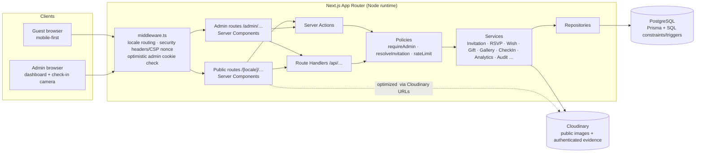
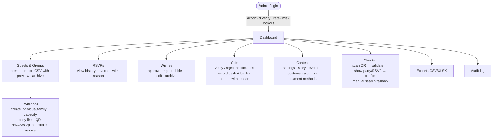
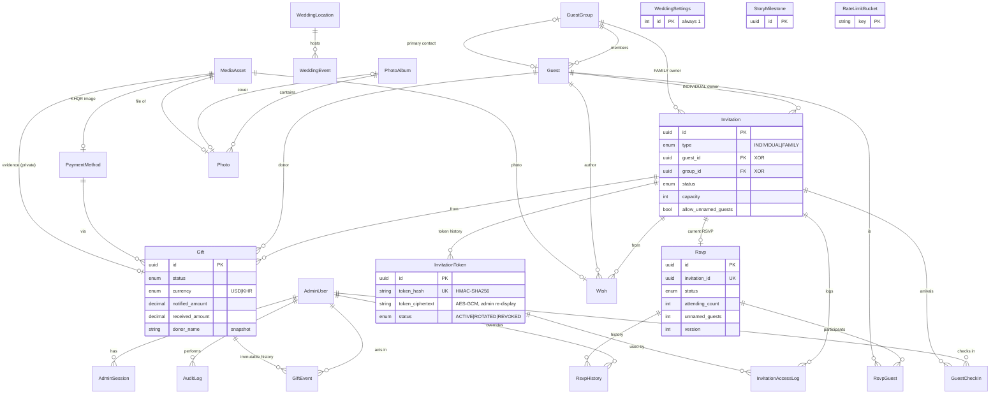
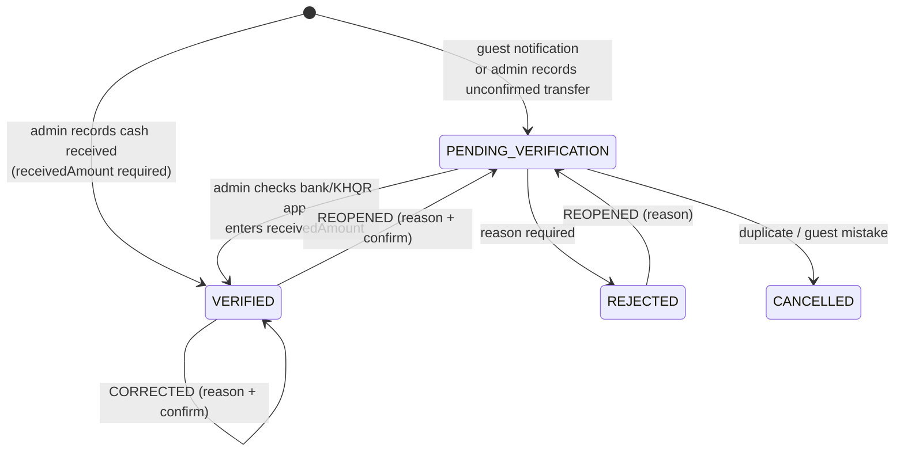

# Sila & Kimsour Wedding Platform — Phase 1: Architecture & Database Design

> Status: **APPROVED** (Phase 1). Companion files: [`schema.prisma`](./schema.prisma) and
> [`constraints.sql`](./constraints.sql) are the original proposals. The live versions are
> `prisma/schema.prisma` and `prisma/migrations/*_db_constraints/migration.sql`.
>
> **Implementation deltas recorded in Phase 2:**
> - Prisma 7: `prisma-client` generator, URLs in `prisma.config.ts`, `pg` driver adapter.
> - Partial unique indexes moved from raw SQL into `schema.prisma` (`partialIndexes` preview), so future migrations never drop them.
> - The optional `pg_trgm` guest-name indexes were dropped (plain B-tree indexes are enough at wedding scale).
> - Next.js 16: `middleware.ts` is now `src/proxy.ts`. Cache Components is deliberately disabled (see README "Rendering model").
> - `DEFAULT_LOCALE` env var renamed to `NEXT_PUBLIC_DEFAULT_LOCALE` (needed in the client bundle; not secret).
> - Default decisions applied (the user approved without answering §18): local Docker Postgres, hash + encrypted token copy, Khmer default, `kh` URL code, local media storage until Cloudinary credentials exist.

Repository inspection: `D:\mine\Invitation-wedding` was **empty** (no existing code to preserve). Node.js v20.19.2 / npm 10.8.2 are installed.

---

## 1. System architecture

One Next.js App Router application (deployed on Vercel or any Node host) serves both the public invitation site and the private admin dashboard. PostgreSQL holds all data. Cloudinary holds all media. Nothing else is required.

| Layer | Responsibility | Location |
|---|---|---|
| UI / presentation | Server Components by default. Client Components only for envelope animation, countdown, lightbox, forms, QR scanner, charts, tables | `src/app`, `src/components` |
| Boundary | Server Actions (first-party mutations) and Route Handlers (exports, uploads, QR images, health, cron). Each one: authenticate → Zod validate → call a service | `src/server/actions`, `src/app/api` |
| Policies | `requireAdmin()`, `resolveInvitationFromToken()`, rate limits | `src/server/policies` |
| Services (use cases) | Business rules, transactions, audit/history writes | `src/server/services` |
| Repositories | Prisma queries only. No business rules | `src/server/repositories` |
| Data | PostgreSQL via Prisma, plus SQL migration for constraints and triggers | `prisma/` |



Notes:
- The middleware check is optimistic only (does a session cookie exist?). The real checks are `requireAdmin()` in every protected layout, every Server Action and every Route Handler, and again in services that take an `AdminContext`.
- Public pages that depend on a token render dynamically with `Cache-Control: private, no-store`. Only fully public content (the home page and the public gallery without the invitation-only albums) can be cached.

---

## 2. User flows

### 2.1 Guest flow

```mermaid
flowchart TD
  S([Guest taps link / scans invitation QR]) --> V{Server validates token<br/>hash lookup + status + expiry<br/>rate-limited}
  V -- invalid / unknown --> X1[Generic “This invitation link is not valid”<br/>no hint whether it exists]
  V -- revoked / inactive / rotated --> X2[“This invitation link is no longer active,<br/>please contact the couple” + contacts]
  V -- valid --> E[Envelope screen<br/>“Dear {display name}” · EN/KH switch]
  E -->|log LANDING, set signed guest cookie| O[Tap “Open Invitation”]
  O -->|log OPENED| R[Reveal: hero · countdown · story · events · gallery · locations · wishes · gift · RSVP CTA]
  R --> RS[RSVP page<br/>attend / decline / maybe<br/>select family members]
  R --> W[Write a wish → PENDING moderation]
  R --> GF[Gift page → KHQR / bank details<br/>optional “I sent a gift” notification → PENDING_VERIFICATION]
  R --> GL[Gallery albums · lightbox · swipe]
  R --> L[Locations · map · directions]
  RS -->|deadline passed| DL[Read-only: “RSVP closed, contact couple”]
```

### 2.2 Admin flow



---

## 3. Entity-relationship diagram



### Relationship explanations

| Relationship | Rule | Enforced by |
|---|---|---|
| Group → Guests | A guest belongs to 0 or 1 group | FK `guests.group_id`, `onDelete: Restrict` |
| Group → primary contact | Must be a member of that group | Trigger `trg_group_primary_contact` |
| Invitation owner | Exactly one of guest or group, matching `type` | CHECK `invitations_owner_xor` |
| One live invitation per owner | At most one non-revoked invitation per guest and per group | Partial unique indexes |
| Grouped guest and individual invite | A guest who is in a group is invited through the group. Service rejects an individual invitation for a grouped guest | `InvitationService` (documented rule) |
| Tokens | Many tokens per invitation over time, exactly one `ACTIVE` | Partial unique index `invitation_tokens_one_active` |
| RSVP | One current RSVP per invitation | `rsvps.invitation_id UNIQUE` |
| RSVP participants | Must be the individual guest or a member of the family group | Trigger and service check |
| Capacity | `attending_count ≤ capacity` | Row lock in service and trigger |
| Gifts | Optional link to invitation/guest, never cascade-deleted | `Restrict` FKs, no-delete trigger |
| History tables | `gift_events`, `rsvp_history`, `audit_logs` are append-only | `forbid_mutation` triggers |
| Media | Every upload is a `MediaAsset`. Unattached assets are cleaned up after 24h | Cron route and `MediaStatus` |

**Historical names:** `Gift.donorName`, `Wish.authorName`, `GuestCheckIn.displayNameSnapshot` and `RsvpHistory.snapshot` store the name *as it was at that time*. Editing a guest later does not rewrite history.

---

## 4. Prisma schema

The full schema is in [`schema.prisma`](./schema.prisma): 22 models (the 20 recommended entities, with `GiftHistory` implemented as `GiftEvent`, plus `MediaAsset`, `StoryMilestone` and `RateLimitBucket`). Key choices:

- **UUID v7** primary keys (`uuid(7)`): unguessable enough for internal IDs and index-friendly. They are still **never** used as public tokens.
- **Localized content** is stored as `Json` columns shaped `{ en: string, kh: string }` and validated by one shared Zod schema, `localizedText`. This avoids sprawling translation tables for a single-site app and keeps both languages in one record. The trade-off is that the DB can't type-check inside JSON, so Zod validates on every write.
- **Money** is `Decimal(18,2)` and handled with `Prisma.Decimal` (decimal.js) end to end. Amounts cross JSON as **strings**. Totals are computed in SQL (`SUM … GROUP BY currency`). A CHECK constraint keeps KHR amounts whole numbers.

---

## 5. Individual vs family invitation ownership

| | Individual | Family / group |
|---|---|---|
| Owner | `guest_id` | `group_id` |
| Greeting | Guest display name in the current locale (falls back to the other language) | Group display name, e.g. “គ្រួសារ លោក សុខ” |
| Named attendees | The one guest | Group members (`Guest.group_id = group`) |
| Capacity default | 1 | Number of members at creation, editable |
| Extra unnamed seats | Only if `allow_unnamed_guests` (e.g. capacity 2 = guest + 1) | Same |
| Records | 1 Invitation | 1 Invitation for the whole family. Members are Guest rows, **never** duplicate invitations |

Rules enforced in `InvitationService` (in a transaction):
1. Creating an INDIVIDUAL invitation for a guest who is in a group is rejected. Invite the group instead, or remove the guest from the group first.
2. Lowering `capacity` below the current RSVP `attending_count` is rejected with a clear message. The admin must override the RSVP first.
3. Adding or removing group members after an RSVP exists is allowed. Removing a member who is an RSVP participant is blocked until the RSVP is updated, because the FK is Restrict.

---

## 6. RSVP participants & capacity enforcement

**Data:** one `Rsvp` row per invitation (current state), `RsvpGuest` rows for each named member with `attending true/false`, `unnamed_guests` for extra seats, and an `RsvpHistory` snapshot for every version.

**Submit/update algorithm (`RSVPService.submit`):**
1. The token is resolved server-side to an invitation. Guest IDs from the client are only *selections*. The client never decides ownership.
2. Zod validates the payload (status, participant ids, unnamed count, text lengths).
3. Deadline check: `now ≤ invitation.rsvpDeadlineOverride ?? settings.rsvpDeadline` (null means open). After the deadline the guest gets a localized “closed” error. Admins use `RSVPService.adminOverride` with a required reason.
4. `MAYBE` is rejected unless `settings.rsvpAllowMaybe`.
5. Transaction:
   - `SELECT … FROM invitations WHERE id = $1 FOR UPDATE`. This serializes concurrent submissions for the same invitation.
   - Re-read the allowed guest set (the individual guest, or non-archived group members) and reject any id outside it.
   - Compute `attending_count = named attending + unnamed_guests`. `DECLINED` forces 0. Reject if it exceeds capacity.
   - Upsert `Rsvp` (`version + 1`), replace `RsvpGuest` rows, insert `RsvpHistory` with a name snapshot.
   - Admin override: also write an `AuditLog`.
6. DB triggers re-check capacity and membership. If a bug ever skips the service check, the transaction still fails.

**Concurrency test:** fire N parallel submissions that each fit alone but together exceed capacity. The test asserts the final state is consistent and `≤ capacity`, and that every history version is sequential.

---

## 7. Secure invitation token strategy

- **Generation:** `crypto.randomBytes(32)` encoded as base64url (43 chars, 256 bits). URL: `/{locale}/invitation/{token}`. The QR code encodes the same URL.
- **Lookup:** store `token_hash = HMAC-SHA256(TOKEN_HASH_PEPPER, token)`, which is unique and indexed. A database leak alone does not reveal working links. Because the token has full entropy, a fast keyed hash is safe here (unlike passwords).
- **Admin re-display (trade-off):** hash-only storage means an admin could see a link **only once**, right after creation. A wedding couple realistically needs to re-copy links and re-print QR codes weeks later. So the token is also stored as `token_ciphertext = AES-256-GCM(TOKEN_ENCRYPTION_KEY, token)`. Lookup never uses the ciphertext. It is decrypted only on explicit admin actions (copy link / QR download), and each of those is audited. A leak of the DB **and** the app key would expose links. That risk is accepted, documented, and mitigated by key separation. The alternative (hash-only, “regenerate to see a link again”) is available if you prefer it. See the questions at the end.
- **Rotation:** in one transaction, set the old token to `ROTATED` with its ciphertext nulled, then insert a new `ACTIVE` token. The old link stops working immediately.
- **Revocation:** the invitation becomes `REVOKED` and all tokens `REVOKED`. `INACTIVE` disables the link temporarily without touching tokens.
- **Guest responses:** an unknown token shows a generic invalid page. A known token that is rotated, revoked or inactive shows “no longer active”. Only the holder of that token sees this, so it leaks nothing about other invitations.
- **Guest session cookie:** after a valid open, a signed, HttpOnly, SameSite=Lax cookie `inv` (`invitationId`, `tokenId`, expiry) unlocks invitation-only albums and wish submission on the `/gallery` and `/wishes` pages without putting the token in every URL. It is re-validated against the DB, so rotation or revocation kills it.
- **Never logged:** raw tokens are excluded from logs, audit metadata and analytics. A `referrer-policy: no-referrer` header on token pages prevents leaking the URL to Google Maps and other third parties.
- **Access logging:** the invitation id, token id, kind, coarse device class and a bot flag. No IP and no full user agent. Link-preview crawlers (Telegram, Facebook, etc.) are flagged and excluded from “opened” metrics. `OPENED` (button press) is the meaningful engagement signal.

---

## 8. Gift verification & financial integrity



- Showing a KHQR image proves nothing. **No automatic verification** is built. Every guest notification starts as `PENDING_VERIFICATION`.
- `notifiedAmount` (what the guest says) and `receivedAmount` (what the admin confirms) are separate columns. Confirmed totals use `receivedAmount` of `VERIFIED` rows only, grouped by currency. Pending totals use `notifiedAmount` of `PENDING_VERIFICATION` rows, also grouped by currency.
- **USD and KHR are never summed together.** No exchange-rate feature is planned.
- Every state change writes a `GiftEvent` (append-only trigger) with before/after (amounts as strings) and an `AuditLog`. Changing a verified gift requires a confirmation dialog and a reason. Gifts are never deleted (trigger). Mistakes become `CANCELLED`/`REJECTED`, or a `CORRECTED` event.
- `Gift.version` gives optimistic locking. Two admins (or two tabs) verifying at once means one wins and the other gets “this gift changed, reload”.
- Payment evidence is uploaded to Cloudinary as delivery type **`authenticated`** (not publicly fetchable). Admin views it through short-lived signed URLs. It is never included in exports.
- **Contributor count definition:** the number of distinct invitations with ≥1 verified gift, plus the number of verified gifts with no invitation (each counted once). It is shown separately per currency and in total, so a family that gave USD and KHR counts once in the total.

---

## 9. English / Khmer localization

- `next-intl` with locales `en` and `kh` (the URL segment requested by the spec). Internally `kh` maps to the BCP-47 `km-KH` for `Intl` date/number formatting, because `kh` is not a valid language tag.
- **Public:** `/[locale]/…` with a prefix always. The `NEXT_LOCALE` cookie remembers the choice. The language switcher keeps the current path.
- **Admin:** `/admin/…` without a prefix. The locale comes from the same cookie and next-intl’s `getRequestConfig` falls back to the cookie when there is no `[locale]` segment.
- UI strings live in `messages/en.json` and `messages/kh.json` (including Zod error messages through a localized error map). Wedding content lives in DB `{en, kh}` JSON. If one language is blank, the page falls back to the other and admin shows a “missing translation” badge.
- **Fonts** (via `next/font`): *Noto Serif Khmer* for Khmer headings, *Noto Sans Khmer* for Khmer body, *Cormorant Garamond* for English headings, *Inter* for English body. Khmer gets extra line-height because of its stacked subscripts.
- **Dates:** formatted with `timeZone: 'Asia/Phnom_Penh'` everywhere. Admin datetime inputs are interpreted as Phnom Penh local time and converted to UTC on the server (Cambodia has no DST, UTC+7).
- **Default locale:** `kh` (proposed. See the questions).

---

## 10. Routes, Server Actions, Route Handlers, services

### 10.1 Public routes

| Route | Purpose | Token? |
|---|---|---|
| `/[locale]` | Generic landing: couple names, date, countdown, “use your personal link” | No |
| `/[locale]/invitation/[token]` | Envelope, then the full personalized invitation (all sections) | Yes |
| `/[locale]/rsvp/[token]` | RSVP form | Yes |
| `/[locale]/gift/[token]` | Payment instructions and gift notification form | Yes |
| `/[locale]/gallery` (+ `/gallery/[slug]`) | Albums. Invitation-only albums visible when the `inv` cookie is valid | Cookie |
| `/[locale]/location` | Venues, maps and directions | No |
| `/[locale]/wishes` | Approved public wishes. Submission requires a valid `inv` cookie | Cookie |

### 10.2 Admin routes

`/admin/login`, then everything under `/admin/(protected)/`: `dashboard`, `invitations`, `guests`, `groups`, `rsvps`, `wishes`, `gifts`, `gallery`, `events`, `locations`, `payment-methods`, `qr-codes`, `check-in`, `analytics`, `settings` (including password change and active sessions), `audit-logs`.

### 10.3 Server Actions (all `"use server"` and Zod-validated)

| Domain | Actions |
|---|---|
| Auth | `login`, `logout`, `changePassword` (revokes other sessions), `revokeSession`, `revokeAllSessions` |
| Guests / Groups | `createGuest`, `updateGuest`, `archiveGuest`, `restoreGuest`, `createGroup`, `updateGroup`, `setGroupMembers`, `setPrimaryContact`, `archiveGroup`, `commitGuestImport` (after the preview step) |
| Invitations | `createIndividualInvitation`, `createFamilyInvitation`, `updateInvitation`, `setInvitationActive`, `revokeInvitation`, `rotateInvitationToken`, `revealInvitationLink` (audited) |
| RSVP (public) | `submitRsvp(token, …)` |
| RSVP (admin) | `overrideRsvp(invitationId, …, reason)` |
| Wishes (public) | `submitWish(…)` (uses the cookie-resolved invitation) |
| Wishes (admin) | `approveWish`, `rejectWish`, `hideWish`, `editWish`, `archiveWish` |
| Gifts (public) | `submitGiftNotification(token, …)` |
| Gifts (admin) | `recordCashGift`, `recordBankGift`, `verifyGift`, `rejectGift`, `cancelGift`, `correctGift`, `reopenGift`, `addGiftNote` |
| Payment methods | `createPaymentMethod`, `updatePaymentMethod`, `setPaymentMethodActive`, `reorderPaymentMethods` |
| Content | `updateSettings`, `updateStory`, CRUD and reorder for `StoryMilestone`, `WeddingEvent`, `WeddingLocation` (archive, not delete, when referenced) |
| Gallery | `createAlbum`, `updateAlbum`, `archiveAlbum`, `attachUploadedPhotos`, `updatePhoto`, `reorderPhotos`, `setAlbumCover`, `deletePhoto` (deletes from Cloudinary and marks the asset `DELETED`) |
| Check-in | `confirmCheckIn(invitationId, arrivedCount, override?, reason?)`, `voidCheckIn(id, reason)` |

### 10.4 Route Handlers

| Handler | Method | Why it is a route handler |
|---|---|---|
| `/api/admin/uploads` | POST | Multipart file stream. Validates MIME, magic bytes, size and dimensions, uploads to Cloudinary, creates a `MediaAsset` (PENDING) |
| `/api/public/gift-evidence` | POST | Same as above, token-scoped and rate-limited. `authenticated` delivery type |
| `/api/public/wish-photo` | POST | Only when the setting is enabled |
| `/api/admin/qr/[invitationId]?format=png\|svg` | GET | Binary download (audited) |
| `/api/admin/check-in/lookup` | POST | Scanner posts the decoded URL/token, gets the party summary back |
| `/api/admin/exports/[resource]?format=csv\|xlsx&…filters` | GET | File download. Resources: guests, groups, invitations, rsvps, check-ins, wishes, gifts. Gifts export is audited |
| `/api/admin/gift-evidence/[giftId]` | GET | Redirects to a short-lived signed Cloudinary URL |
| `/api/cron/cleanup` | POST | `CRON_SECRET` header. Deletes PENDING media older than 24h, expired sessions and expired rate-limit buckets |
| `/api/health` | GET | Liveness plus a DB ping (no data) |

### 10.5 Services → repositories

`AuthService`, `InvitationService` (incl. token crypto), `GuestService`, `GuestGroupService`, `RSVPService`, `WishService`, `GiftService`, `PaymentMethodService`, `GalleryService` (+ `MediaService` for Cloudinary), `WeddingContentService` (settings, story, milestones), `WeddingEventService`, `LocationService`, `CheckInService`, `AnalyticsService`, `ExportService`, `AuditLogService`, `RateLimitService`. Each service has a matching repository where it touches its own tables. Services receive an explicit context (`AdminContext` or `GuestInvitationContext`) and never read cookies themselves, which keeps them unit-testable.

---

## 11. Dashboard metric definitions

| Metric | Definition |
|---|---|
| Total invitations | Invitations with status ≠ REVOKED (split by INDIVIDUAL / FAMILY) |
| Invited guests | Distinct non-archived named guests covered by those invitations (individual guest + group members) |
| Invited seats | Sum of `capacity` across those invitations |
| Invitations opened | Invitations with ≥1 non-bot `OPENED` access log |
| Pending RSVP | Live invitations with no `Rsvp` row |
| Attending guests | Sum of `attending_count` over ATTENDING RSVPs (includes unnamed seats) |
| Declined guests | Named guests with `attending=false` on any RSVP, plus every named guest of a DECLINED RSVP with no participant rows. Each guest counted once |
| Maybe guests | Sum of `attending_count` over MAYBE RSVPs (only shown if enabled) |
| Wishes | Counts by status |
| Verified gifts | `SUM(received_amount)` WHERE VERIFIED, **per currency** |
| Pending gifts | Count, plus `SUM(notified_amount)` per currency WHERE PENDING_VERIFICATION |
| Checked-in guests | `SUM(arrived_count)` of non-voided check-ins |

Charts (Recharts): RSVP status donut, cumulative attending over time, daily opens (bots excluded), guests by category, verified gifts over time (one series per currency, separate axes or charts), and gift count by method.

---

## 12. Security threat analysis

| Threat | Mitigation |
|---|---|
| Guessing / enumerating invitation links | 256-bit random tokens. Hash lookup. Rate limit per IP-hash on token routes. Generic invalid response. No sequential IDs in URLs |
| Token leakage via Referer, logs or analytics | `Referrer-Policy: no-referrer` on token pages. Tokens never logged. No third-party analytics on token pages |
| Leaked DB dump | Token hashes are useless without the pepper. Ciphertext is useless without the encryption key. Passwords use Argon2id. Session ids are stored hashed |
| Admin brute force | Rate limit per IP-hash and per username. Account lock after 10 failures for 15 min. Constant-time comparison. Generic “invalid credentials” |
| Session theft / fixation | `__Host-admin_session` cookie: HttpOnly, Secure (prod), SameSite=Strict, Path=/. Random 256-bit value stored hashed. New session on login. 12h idle and 7d absolute expiry. Revocation list in DB. Password change revokes all other sessions |
| CSRF | Server Actions have Next.js built-in Origin/Host checking. Mutating route handlers verify the `Origin` header against `APP_URL`. SameSite=Strict admin cookie |
| Broken access control | `requireAdmin()` in the layout, every action, every handler and the service context. Public endpoints resolve the invitation from the token or cookie, never from client-sent ids. Explicit `select` projections so public DTOs never include phone, email, notes or gift data |
| IDOR across invitations | RSVP participants are validated against the token's owner (service and trigger). Gift/guest associations are derived server-side |
| XSS | React escaping. Wishes and all user text are rendered as plain text (no `dangerouslySetInnerHTML`). Strict CSP with per-request nonce. Map embed URLs restricted to allow-listed Google Maps hosts |
| Malicious uploads | Max size (10 MB images, 5 MB evidence). Allowed types JPEG/PNG/WebP/HEIC verified by magic bytes (`file-type`). Re-encoded by Cloudinary. SVG rejected |
| Spam wishes / gift notifications | Postgres-backed rate limits per invitation and per IP-hash. Content-hash duplicate detection. Length limits. Honeypot field. Moderation by default |
| CSV/Excel formula injection | Export cells starting with `= + - @ \t \r` are prefixed with `'` |
| Financial tampering / errors | Decimal only. Append-only gift events. No gift deletion. Optimistic locking. Reasons required. Audit log |
| Private data in caches | Token, cookie and admin responses get `Cache-Control: private, no-store`. No `unstable_cache` on private queries |
| Secrets in the client bundle | `server-only` import guard on server modules. Env schema splits server and public vars. Only `NEXT_PUBLIC_CLOUDINARY_CLOUD_NAME` is public |
| Clickjacking | `frame-ancestors 'none'`. Also `X-Content-Type-Options: nosniff`, HSTS, and `Permissions-Policy: camera=(self)` (needed for check-in) |
| Shared admin account | Audit logs say “Shared couple account” and **cannot** tell which partner acted. This is documented in the README and shown on the audit-log page. The schema already has `AdminRole` and per-user sessions for future separate accounts |

---

## 13. Project structure

The structure follows spec §12, with these concrete additions:

```text
src/
  app/
    [locale]/ (page, invitation/[token], rsvp/[token], gift/[token], gallery/[[...slug]], location, wishes)
    admin/login/, admin/(protected)/{dashboard,…,audit-logs}/
    api/{admin/…, public/…, cron/cleanup, health}/
  components/{ui (shadcn), wedding, invitation, gallery, rsvp, gifts, admin}/
  features/<domain>/{schemas.ts, components/}          # Zod schemas shared by form + action
  server/{actions, services, repositories, policies}/
  lib/{prisma, auth, validation, security (crypto, rate-limit, headers), storage (cloudinary), qr, money (Decimal helpers), dates (Phnom Penh tz), env.ts}
  i18n/{routing.ts, request.ts, navigation.ts}
messages/{en.json, kh.json}
prisma/{schema.prisma, migrations/, seed.ts}
tests/{unit, integration (real Postgres via docker compose), e2e (Playwright)}
docker-compose.yml   # local Postgres for dev + tests
```

---

## 14. Environment variables (`.env.example` plan)

| Variable | Scope | Purpose |
|---|---|---|
| `DATABASE_URL` | server | Pooled connection (least-privilege app role: no DDL) |
| `DIRECT_URL` | server | Direct connection used for migrations only (migration role) |
| `APP_URL` | server | Canonical origin, e.g. `https://example.com`. Used for links, QR codes and the Origin check |
| `AUTH_SECRET` | server | ≥32 bytes. Signs the guest `inv` cookie |
| `TOKEN_HASH_PEPPER` | server | ≥32 bytes. HMAC key for invitation token lookup. **Changing it invalidates all links** |
| `TOKEN_ENCRYPTION_KEY` | server | 32-byte base64 AES-256-GCM key for admin link re-display |
| `DEFAULT_LOCALE` | server | `kh` or `en` |
| `TIME_ZONE` | server | `Asia/Phnom_Penh` |
| `CLOUDINARY_CLOUD_NAME` / `CLOUDINARY_API_KEY` / `CLOUDINARY_API_SECRET` | server | Media |
| `CLOUDINARY_FOLDER` | server | e.g. `sila-kimsour` (separate folder per environment) |
| `NEXT_PUBLIC_CLOUDINARY_CLOUD_NAME` | public | Building image URLs on the client (not secret) |
| `CRON_SECRET` | server | Auth for `/api/cron/cleanup` |
| `ADMIN_SEED_USERNAME` / `ADMIN_SEED_PASSWORD` | seed only | Used once by `prisma db seed`. Must not be set in production after seeding |
| `LOG_LEVEL` | server | `info` default |
| `SENTRY_DSN` | server (optional) | Error monitoring if desired |

All variables are validated at startup with a Zod schema in `src/lib/env.ts`. The app refuses to boot when a required variable is missing or too short.

---

## 15. Library choices

Exact versions will be resolved with `npm view` at the start of Phase 2, pinned in `package.json` and recorded in the README. I won't guess version numbers here.

| Need | Choice | Reason |
|---|---|---|
| Framework | Next.js (latest stable App Router), React, TypeScript `strict` | Spec |
| Styling | Tailwind CSS + shadcn/ui, Framer Motion, Lucide | Spec |
| i18n | next-intl | Spec. App Router native |
| DB | PostgreSQL 16+, Prisma | Spec |
| Validation / forms | Zod, React Hook Form (+ `@hookform/resolvers`) | Spec |
| Tables / charts / toasts | TanStack Table, Recharts, Sonner | Spec |
| Password hashing | `@node-rs/argon2` (Argon2id) | Prebuilt binaries (works on Windows and Vercel), no node-gyp |
| Media | `cloudinary` SDK (server only) | Spec |
| Upload sniffing | `file-type` | Magic-byte validation |
| QR generation | `qrcode` | Maintained. PNG and SVG output |
| QR scanning | `@yudiel/react-qr-scanner` | Actively maintained React wrapper using the BarcodeDetector API with a polyfill |
| Excel export | `exceljs` | Streaming XLSX |
| Gallery lightbox | `yet-another-react-lightbox` | Swipe, keyboard, accessible, lazy |
| Decimal | `Prisma.Decimal` (decimal.js) | No extra dependency |
| Testing | Vitest, React Testing Library, Playwright | Spec |
| Local DB | Docker Compose `postgres:16` | Integration tests need a real Postgres for the triggers |

---

## 16. Phase-by-phase plan

| Phase | Deliverables | Verification |
|---|---|---|
| **2 Foundation** | Next.js + TS strict, Tailwind design tokens (palette from spec §4), fonts, shadcn/ui, next-intl EN/KH routing, env validation, Prisma schema + init migration + `constraints.sql` migration, docker-compose Postgres, base public/admin layouts, security headers | `tsc`, lint, `prisma migrate dev`, constraint integration tests, app boots in both locales |
| **3 Auth & core data** | Seed admin, login/logout/sessions/password change, `requireAdmin`, audit service, rate limiter, guests/groups CRUD + import preview, invitations (both types), token create/rotate/revoke/reveal, access logging | Unit + integration tests (spec scenarios 1–5, 18) |
| **4 Public experience** | Envelope opening, hero, countdown / post-wedding, story & milestones, events, gallery with lightbox, locations & directions, admin content editors for these | RTL tests, Playwright mobile viewport, reduced-motion |
| **5 Guest interactions** | RSVP (capacity, history, deadline), wishes (moderation, rate limits), gift page + notification + private evidence | Scenarios 6–17, 20 |
| **6 Admin dashboard** | Overview + analytics charts, all management tables (TanStack, paginated server-side), gift verification UI, payment methods/KHQR, QR download/print, check-in scanner + manual fallback, exports, audit-log viewer | Scenarios 19, 23, 24 |
| **7 Hardening** | Full test suite, accessibility pass, security review, concurrency tests, performance | All tests green (results reported as actually run) |
| **8 Deployment** | Vercel + managed Postgres + Cloudinary setup guide, migration/rollback procedure, backup/restore (pg_dump schedule, Cloudinary backup), cron, smoke tests | Production smoke checklist |

---

## 17. Assumptions (safe defaults, all changeable)

1. **No wedding facts are invented.** Date, events, venues, coordinates, bank/KHQR data, contacts and stories all start empty. The admin dashboard shows a “Setup checklist” listing every missing value. Public sections with no data are hidden instead of showing placeholders.
2. English name transliterations start blank. Only the Khmer names from the spec (មាស សិលា, មឿក គឹមសួ) are seeded.
3. RSVP “Maybe” is **off** by default. There is no RSVP deadline until one is set.
4. Wish photos are **off** by default. Gift evidence upload is **on** (private).
5. Wish submission requires a valid invitation (cookie from opening the invite). Anonymous public wishes are not allowed, which reduces spam.
6. A grouped guest cannot also have an individual invitation.
7. Check-in: a second check-in for the same invitation is blocked unless “override” is chosen with a reason (for example, a family arriving in two cars).
8. Optional background music (admin-uploaded, off until set, never autoplays with sound) is included because it is common on wedding invitations. It is muted until the guest taps play.
9. Rate limiting uses Postgres (no Redis), which is sufficient at wedding scale.
10. Admin UI is bilingual through the same cookie as the public site.

## 18. Questions for you (blocking or important)

1. **Database for development:** can I use **Docker Desktop** locally for PostgreSQL (recommended, and needed for the trigger tests)? Or would you rather use a hosted dev database such as Neon or Supabase and give me the connection string?
2. **Cloudinary:** do you already have an account? Until credentials exist, I'll build an upload adapter that stores files on local disk in development only, so Phase 2–4 can proceed.
3. **Invitation link re-display:** do you approve the **hash + encrypted copy** strategy (§7) so you can re-copy links and QR codes any time? The alternative is hash-only, where you can see a link only when it's created or regenerated.
4. **Default language** for new visitors and QR links: Khmer (`kh`, proposed) or English?
5. **Locale code:** the spec says `kh` in URLs. `km` is the correct ISO code for Khmer, but `kh` is friendlier to read. I'll use `kh` as specified unless you prefer `km`.
6. **Production domain:** do you have one yet? It's only needed by Phase 8.

**Please reply “Approve Phase 1” (with answers or changes) and I will start Phase 2 (project foundation).**
